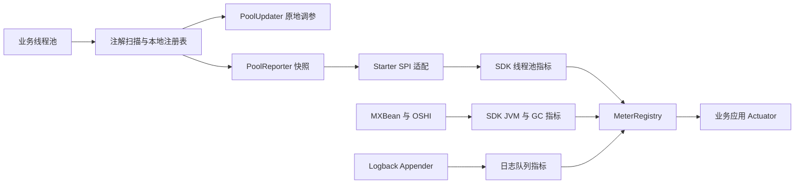

# 枫落 FengLuo

**面向 Spring Boot 服务的动态线程池管理与可观测性项目。**

枫落围绕业务线程池的注册、运行状态查看和参数调整，逐步建设配置管理、异常观测与运维管理能力。当前开发重点是把单 JVM 内的线程池管理做完整，再接入配置中心和多实例管理。

> 项目处于开发阶段。目前可以尝试本地线程池注册、查询与动态调参；远程配置下发、实例生效反馈和完整管理平台尚未完成。模块目录的存在不代表相应功能已交付。


## 技术基线与阅读顺序

| 项目 | 当前配置 |
| --- | --- |
| Java | JDK 17 |
| Spring Boot | 3.3.5 |
| Spring Cloud | 2023.0.3 |
| Spring Cloud Alibaba | 2023.0.1.0 |
| 构建 | Maven 多模块工程，版本 `1.0-SNAPSHOT` |
| 数据与基础设施 | MySQL / MyBatis-Plus、Redis、Nacos；搜索模块配置 Elasticsearch |
| 观测 | Micrometer、Actuator、Prometheus Registry、MXBean 与 OSHI |

版本以各模块 POM 为准。先阅读当前能力与项目结构，再按需接入动态线程池或 Starter；完整业务服务还需要数据库、缓存与配置中心。

## 项目解决什么问题

业务服务通常包含邮件发送、异步处理、后台任务等线程池。线程池创建后，需要明确它的名称、当前运行状态、参数调整方式，以及服务关闭时由谁负责释放资源。

枫落当前提供以下本地能力：

- **统一注册**：发现明确标注的线程池 Bean、字段和无参方法，保存实际对象引用。
- **原地调参**：按名称调整核心线程数、最大线程数和存活时间，业务继续使用原线程池。
- **运行状态查询**：获取线程数、活跃数、队列长度、完成任务数等本地快照。
- **队列容量调整**：自定义队列支持扩缩容，缩容保留已有任务。
- **生命周期管理**：清理已终止线程池的注册记录，并在容器关闭时执行关闭与等待。

在此基础上，项目计划提供“配置发布 → 实例应用 → 结果反馈 → 状态查询”的管理流程。任务调度、通知与搜索是平台扩展方向。

## 当前能力与进度

| 领域 | 当前情况                                      |
|---|-------------------------------------------|
| 动态线程池 | 已实现本地注册、重名检查、原地调参、状态快照、队列容量调整和关闭管理        |
| Spring 接入 | 已实现注解扫描与自动配置；保留观测启动器的兼容导入入口               |
| 观测能力 | 已实现异常处理、JVM 补充指标、GC 事件和线程池指标的 Micrometer SDK 与 Starter 自动配置 |
| 日志指标 | 已有 Logback 有界内存快照、接收/淘汰计数与队列长度指标；集中采集与检索未完成 |
| 账号与权限 | 已有用户、角色、菜单、用户角色关系及 JWT/Redis 认证授权代码       |
| 网关 | 已有请求标识透传、路径检查和鉴权，当前用户服务路由为 `/maple/**`    |
| 配置管理 | 已有线程池配置与快照的数据模型、Mapper 和基础服务代码，尚未完成远程应用流程 |
| 任务调度 | 已有任务定义、执行记录、分组与关联的数据模型及基础代码，调度执行链路待建设     |
| 搜索 | 已有 Elasticsearch 客户端配置；索引初始化 Runner 为空，业务检索待实现 |
| 监控中心与通知 | 模块已规划，集中管理与通知流程待建设                        |

上表描述已有代码，整体验收状态见文末。配置和任务控制器目前只有类级路径，没有业务方法；Quartz 示例位于测试目录。API 资产发现、行为基线、安全研判、防护回执与审计中心属于开发文档中的目标设计。

## 项目结构

```text
FengLuo/
├── Fengluo_DynamicTP/              # 动态线程池、注册管理与调参实现
├── Fengluo-Observability-Starter/   # 异常处理、Actuator/Prometheus、监控自动配置
├── Fengluo-Config/                 # 线程池配置与配置快照管理
├── Fengluo-Monitor/                # 监控模块集合
│   ├── Fengluo-Monitor-SDK/        # Micrometer MeterBinder、GC 订阅与线程池定时采集
│   └── Fengluo-Monitor-Service/    # 本地 MXBean / OSHI 与 GC 通知采集工具
├── Fengluo-Task/                   # 任务定义、分组与执行记录
├── Fengluo-Event/                  # 本地 Spring 事件与发布器
├── Fengluo-Notice/                 # 通知模块，待建设
├── Fengluo-Search/                 # Elasticsearch 搜索服务基础
├── Fengluo-User/                   # 账号、用户、角色与菜单
├── Fengluo-Auth/auth-service/      # 共享认证授权组件
├── Geteway/                       # 网关，沿用当前目录拼写
├── FengLuo-Api/                   # 服务间调用基础依赖
├── Fengluo-Common/                # 统一响应、异常与公共工具
├── sql/                           # 本地数据库脚本，当前被 Git 忽略
├── doc/                           # 本地设计与代码解读，当前被 Git 忽略
├── README.md                      # 项目入口、接入说明与验证状态
└── pom.xml                        # Maven 聚合构建与版本管理
```

### 本地观测链路



图示为已编码组件的关系。配置更新事件目前通过进程内 Spring 事件传递，远程发布、版本与实例回执尚未闭环；Prometheus 抓取目标也需要另行配置。

## 快速体验动态线程池

### 1. 环境与构建

准备 JDK 17、Maven 3.x，通过 `java -version` 与 `mvn -version` 确认 Maven 使用 JDK 17。先解决文末列出的构建问题，再在仓库根目录安装 Starter 及其依赖：

```shell
mvn -pl Fengluo-Observability-Starter -am install
```

本地线程池管理本身不需要启动 MySQL、Redis 或 Nacos；宿主应用的其他组件可能需要这些服务。线程池实现位于 Fengluo_DynamicTP，Bean 自动配置由 Observability-Starter 提供；当前依赖链尚不是独立的纯 JDK Core。

### 2. 在 Spring Boot 应用中引入依赖

```xml
<dependency>
    <groupId>com.fengluo</groupId>
    <artifactId>Fengluo-Observability-starter</artifactId>
    <version>1.0-SNAPSHOT</version>
</dependency>
```

当前示例使用本地安装的 SNAPSHOT 构件，不假设已发布到公共 Maven 仓库。

启用自动注册：

```yaml
monitor:
  threadpool:
    dynamic:
      enabled: true
```

### 3. 注册业务线程池

在业务配置类中声明：

```java
import com.guilu.annotation.DynamicThreadPool;
import com.guilu.DynamicThreadPool.FLBlockingQueue.CapacityBlockingQueue;
import org.springframework.context.annotation.Bean;
import org.springframework.context.annotation.Configuration;
import java.util.concurrent.*;

@Configuration(proxyBeanMethods = false)
public class BusinessPoolConfiguration {
    @Bean("dynamicTP2")
    @DynamicThreadPool(name = "dynamicTP2")
    public ExecutorService createTP2() {
        return Executors.newFixedThreadPool(2);
    }
    
    @Bean("dynamicTP3")
    @DynamicThreadPool(name = "dynamicTP3")
    public ThreadPoolExecutor createTP3() {
        return new ThreadPoolExecutor(
                2, 8, 60, TimeUnit.SECONDS,
                new CapacityBlockingQueue<Runnable>(100));
    }
}
```

对上述 `@Bean` 工厂方法，显式 Bean 名优先；未显式命名时，依次使用 `@DynamicThreadPool(name)`、DynamicPool 内部名称、自动生成的 `dynamic_tp_N`。需要时通过 Spring 别名暴露管理名称，原方法名保留。建议显式 Bean 名与管理名保持一致。

也支持标注普通 Bean 的字段或无参、非 `@Bean` 方法；它们按注解名与注册器传入名称解析，详见动态线程池文档。标注方法会在扫描时调用，业务应使用注册后的同一对象提交任务。

### 4. 查询与调整

在线程池完成注册后调用：

```java
ExecutorService executor = PoolInquirer.of().getPool("dynamicTP2");

// 核心线程数 4、最大线程数 12、存活时间 60 秒，队列容量保持不变。
PoolUpdater.of()
    .update("dynamicTP2", 4, 12, 60L, TimeUnit.SECONDS, null);

// dynamicTP3 使用 CapacityBlockingQueue，将其容量从 100 调整为 200。
PoolUpdater.of()
    .update("dynamicTP3", null, null, null, null, 200);

var snapshot = new PoolReporter(environment).snapshot();
```

`dynamicTP2` 来自 `newFixedThreadPool`，使用无界 LinkedBlockingQueue，不支持动态调整容量，因此传 `null`。在该队列未满时，调高最大线程数不会触发额外扩线程。需要有界积压与动态容量时，可使用示例中的 `dynamicTP3`。

更新参数使用包装类型，`null` 表示保持不变；显式更新存活时间时需要提供单位。CapacityBlockingQueue 缩容不删除已有任务，任务数降到新容量以下后才继续接收入队。注册池会参与应用关闭管理，外部共享池需明确生命周期归属。

## 接入可观测性 Starter

先在仓库根目录安装 Starter 及其依赖：

```shell
mvn -pl Fengluo-Observability-Starter -am install
```

业务应用引入以下依赖；构件名称中的 `starter` 为小写：

```xml
<dependency>
    <groupId>com.fengluo</groupId>
    <artifactId>Fengluo-Observability-starter</artifactId>
    <version>1.0-SNAPSHOT</version>
</dependency>
```

Starter 包含 Actuator 和 Prometheus Registry。基础 JVM、Buffer、类加载、线程及 CPU 指标沿用 Spring Boot 自动配置；SDK 使用 `fengluo.*` 前缀注册补充指标。Prometheus 使用当前 `prometheusmetrics` 实现，不再同时引入旧版 simpleclient Registry。

```yaml
monitor:
  metrics:
    enabled: true
    jvm-enabled: true
    gc-enabled: true
    executor-enabled: true
    executor-refresh-interval: 10s
    jvm-refresh-interval: 10s
    sys-detail-info: false
    logging:
      enabled: false
  threadpool:
    dynamic:
      enabled: true
  exception:
    enabled: true
  jvm:
    extras:
      enabled: true
  banner:
    enabled: true
management:
  endpoints:
    web:
      exposure:
        include: health,prometheus
```

上述 YAML 适用于已有 Web 服务。启动后访问 `/actuator/prometheus`，若服务配置了 context-path，需在路径前加上该前缀。例如用户服务设置 `/maple` 后，路径为 `/maple/actuator/prometheus`。可在 Prometheus 文本中搜索 `fengluo_`；端点访问权限由业务应用的安全配置决定。

### 配置开关

| 配置项 | 默认值 | 作用 |
| --- | --- | --- |
| `monitor.metrics.enabled` | `true` | 控制 SDK 补充指标的自动配置 |
| `monitor.metrics.jvm-enabled` | `true` | 内存池峰值/GC 后用量、阈值、进程内存和 CPU 时间、死锁数量 |
| `monitor.metrics.gc-enabled` | `true` | 订阅 GC 通知并记录带原因和动作的事件 Timer |
| `monitor.metrics.executor-enabled` | `true` | 存在 ThreadPoolSnapshotSource 时采集；默认通过 PoolReporter 适配 |
| `monitor.metrics.jvm-refresh-interval` | `10s` | 系统指标、死锁数量与 OSHI 明细缓存 TTL，至少 `1ms` |
| `monitor.metrics.sys-detail-info` | `false` | 开启 OSHI CPU 分项与内存明细 |
| `monitor.metrics.logging.enabled` | 属性类 `false`，条件缺省匹配 | 日志自动配置独立开关；请显式设置，见下文 |
| `monitor.metrics.logging.log-cap` | `1500` | 总日志队列容量，另有同等总容量的分级队列；必须至少为 5 |
| `monitor.metrics.logging.metrics-type` | `BASICEXPAND` | 当前仅这一枚举，装配固定使用 BasicExpandMetricsBinder |
| `monitor.metrics.executor-refresh-interval` | `10s` | 线程池快照与发现间隔，至少 `1ms` |
| `monitor.threadpool.dynamic.enabled` | `false` | 启用注解注册、调参和 PoolReporter 等线程池管理组件 |
| `monitor.jvm.extras.enabled` | `true` | 原有 micrometer-jvm-extras 进程扩展指标 |
| `monitor.exception.enabled` | `true` | 存在 MeterRegistry 的 Servlet 应用启用异常处理；切面另需 AOP 支持 |
| `monitor.banner.enabled` | `true` | 启动时打印 classpath 中的 OB 横幅 |

关闭 `monitor.metrics.enabled` 会关闭 JVM、GC、默认 Reporter 适配与线程池 Binder 配置；Actuator 基础指标、进程扩展指标、异常处理与日志采集由各自条件控制。尤其需要显式配置 `monitor.metrics.logging.enabled=false` 才能可靠关闭当前日志自动配置。应用可定义对应类型的 Binder Bean 替换默认实现。

`monitor.metrics.*` 通过 `MonitorMetricsProperties` 类型化绑定，配置元数据提供 IDE 提示。例如 `executor-refresh-interval: 10s` 对应 Java 的 `Duration.ofSeconds(10)`；配置统一使用上表的短横线命名。

### 自动配置与 Bean 归属

OB 模块通过 `META-INF/spring/org.springframework.boot.autoconfigure.AutoConfiguration.imports` 加载以下七个正式入口。业务应用引入 Starter 后无需扫描其配置包或手动导入配置类。

| 自动配置类（`com.guilu.config` 包） | 注册职责 | 条件与顺序 |
| --- | --- | --- |
| `DynamicPoolAutoConfiguration` | 线程池注册后处理器、PoolRegister、PoolInquirer、PoolUpdater、PoolReporter、PoolLifecycle 和更新监听器 | `monitor.threadpool.dynamic.enabled=true` |
| `MonitorMetricsAutoConfiguration` | JvmSupplementMetrics、GcMetricsBinder、MonitorMetricsProperties 及 Reporter → SPI 适配 | 在线程池配置之后加载；受总开关及分项开关控制 |
| `ThreadPoolMetricsAutoConfiguration` | ThreadPoolMetricsBinder | 在 MonitorMetricsAutoConfiguration 之后；需要 ThreadPoolSnapshotSource，且总开关和 executor-enabled 开启 |
| `LoggingMetricsAutoConfiguration` | BasicExpandMetricsBinder、ExpandAppender | 独立判断 monitor.metrics.logging.enabled；缺省匹配，不依赖 metrics 总开关 |
| `JvmExtrasAutoConfiguration` | ProcessMemoryMetrics、ProcessThreadMetrics、缺失时的 JvmInfoMetrics | 在 Boot 的 JVM 配置之后加载，受 `monitor.jvm.extras.enabled` 控制 |
| `GlobalExceptionAutoConfiguration` | GlobalExceptionHandler 和条件化的 GlobalExceptionAspect | 在 Registry 与 AOP 配置之后加载；需要 Servlet 环境及 MeterRegistry，切面另需 AOP 自动代理器且 `spring.aop.auto` 未关闭 |
| `ObservabilityAutoConfiguration` | 启动横幅 ApplicationRunner | 受 `monitor.banner.enabled` 控制，从 classpath 读取资源 |

多数功能 Bean 使用 `@ConditionalOnMissingBean`，应用提供对应类型 Bean 时默认注册退让；日志配置中的 ExpandAppender Bean 没有该退让条件。线程池管理配置保留 `ThreadPoolUpdater`、`ThreadPoolInquirer`、`ThreadPoolReporter` 等既有 Bean 别名。

`ThreadRegisterConfiguration` 与 `MonitorMetricsConfiguration` 为已弃用的显式导入兼容入口，分别转交线程池和指标正式配置；它们不再出现在自动配置清单中。新接入直接使用 Starter 和配置开关即可。禁用 `spring.aop.auto` 后，符合条件的异常处理器仍可注册，但不创建默认异常切面。

### 补充指标清单

| Micrometer 名称 | 类型、单位及标签 |
| --- | --- |
| `fengluo.jvm.memory.pool.peak` / `.collection` | Gauge，字节；`pool`、`area`、`value` 标签；value 为 init/used/committed/max |
| `fengluo.jvm.memory.pool.threshold.supported` / `.bytes` / `.count` / `.exceeded` | Gauge；`pool`、`kind` 标签；kind 为 usage/collection；bytes 单位为字节，其余为状态或累计次数 |
| `fengluo.system.memory.total` / `.free` | Gauge，字节 |
| `fengluo.process.memory.virtual` | Gauge，字节 |
| `fengluo.process.cpu.time` | FunctionCounter，进程累计 CPU 秒数 |
| `fengluo.jvm.threads.deadlocked` | Gauge，死锁线程数量 |
| `fengluo.jvm.gc.event` | Timer；`collector`、`cause`、`action` 标签；记录 GC 事件次数和耗时 |
| `fengluo.executor.size` / `.core` / `.max` / `.largest` / `.active` | Gauge，线程数；`pool` 标签 |
| `fengluo.executor.queue.size` / `.queue.remaining` | Gauge，队列任务数及剩余容量；`pool` 标签 |
| `fengluo.executor.tasks` / `.completed` | Gauge，任务累计数量快照；`pool` 标签 |
| `fengluo.executor.queue.capacity` / `.keep.alive` | Gauge，队列容量与线程存活秒数；无界容量输出 NaN |
| `fengluo.executor.status` / `.info` | Gauge，关闭状态及线程池元数据标签 |
| `fengluo.executor.rejected` | FunctionCounter，仅来源提供拒绝统计时注册 |

不支持或未知的数值输出为 NaN，阈值为 0 表示阈值检查关闭。采集不修改内存阈值、不重置峰值，也不自动开启线程 CPU/锁争用监控。GC Timer 仅统计订阅后的事件，输入毫秒由 Micrometer 转换为 Registry 的时间单位；Prometheus 输出为秒。

线程池指标复用 `PoolReporter` 和 `DynamicPoolSnapshot`：初始化时读取一次，之后定时发现新注册池并更新快照，移除不再上报的池对应指标。采集器只读线程池状态；关闭时停止自身采集线程并移除线程池指标，GC Binder 关闭时解除通知订阅。线程池自身的关闭仍由原有 PoolLifecycle 管理。

逐线程 CPU 时间、锁等待、死锁堆栈及完整 GC 前后内存详情通过 Monitor-Service 的 Java 采集方法按需读取，目前没有独立 HTTP 诊断控制器。线程池 info 指标包含 thread_id/thread_name 等元数据；逐线程堆栈不自动注册为标签。GC 并发阶段耗时拆分需另接 JFR/GC 日志；任务执行和排队耗时需上层任务装饰器记录，当前 Binder 不包装业务任务。

### 手动使用 Monitor-SDK

JvmSupplementMetrics、GcMetricsBinder 当前包声明为 `com.guilu.monitor.sdk`，ThreadPoolMetricsBinder 位于 `.sdk.binder`；Starter 导入不一致尚需统一。以下导入按当前 SDK 声明编写，包结构修复后需同步核对。

手动接入使用 `com.fengluo:Fengluo-Monitor-SDK:1.0-SNAPSHOT`，由应用提供 Registry 与 ThreadPoolSnapshotSource。以下为业务方法内片段：

```java
import com.guilu.monitor.sdk.JvmSupplementMetrics;
import com.guilu.monitor.sdk.GcMetricsBinder;
import com.guilu.monitor.sdk.binder.ThreadPoolMetricsBinder;
import com.guilu.monitor.sdk.spi.ThreadPoolSnapshotSource;
import java.time.Duration;

// registry 为现有 MeterRegistry；source 为应用实现的 ThreadPoolSnapshotSource。
new JvmSupplementMetrics().bindTo(registry);
GcMetricsBinder gc = new GcMetricsBinder();
gc.bindTo(registry);
ThreadPoolMetricsBinder pools = new ThreadPoolMetricsBinder(source, Duration.ofSeconds(10));
pools.bindTo(registry);
```

已有 Starter 和 PoolReporter 时，可用 `com.guilu.metrics.PoolReporterSnapshotSource` 适配；该适配器不属于纯 SDK API。

手动调用本身只绑定这些指标，基础 JVM 指标由宿主应用选择。当前 SDK 依赖中也包含 Actuator 与 Prometheus Registry，若作为 Boot 依赖引入，仍需考虑宿主自动配置行为。SDK 不主动创建 HTTP 服务或推送远程平台。Starter 模式由 Spring 绑定并管理相应 Bean，无需重复手工绑定。

手动模式需在应用退出时调用 `pools.close()` 和 `gc.close()`，释放定时采集线程和 GC 通知订阅。Binder 不负责关闭传入的 Registry 或业务线程池。

### 日志指标接入边界

显式配置 `monitor.metrics.logging.enabled=true` 启用 Logback 内存快照与队列指标，`false` 关闭。该自动配置不受 `monitor.metrics.enabled` 控制；未配置日志开关时，条件中的 `matchIfMissing=true` 会匹配，即使属性对象默认值为 false。

`log-cap` 默认 1500、最少为 5。总队列容量为 C，五个级别队列合计容量也为 C；每条快照同时进入总队列与对应级别队列。满时淘汰旧记录保留新记录，应用退出后记录不会保留。当前支持 Logback，未实现 Log4j2 Appender 接入。

`total.offered` 记录直接 offer 成功次数，`total.evicted` 记录淘汰替换路径，不能将后者直接解释为新日志写入失败。日志 Binder 的 `close()` 目前为空；内存快照不提供集中存储、检索接口或异常堆栈。详细指标见[日志说明](Fengluo-Monitor/Fengluo-Monitor-SDK/doc/日志记录以及指标器.md)。

## 构建与验证记录

```shell
mvn -pl Fengluo-Observability-Starter -am clean compile
mvn -pl Fengluo-Observability-Starter -am test
mvn -pl Geteway,Fengluo-User -am compile
```

| 检查 | 实际结果 |
| --- | --- |
| Starter 及依赖模块测试 | 未通过。Monitor-Service 的 MetricsTest 运行 6 项，1 项 error；Windows OSHI/JNA 抛 `Invalid memory access`，后续模块跳过 |
| Starter 及依赖模块增量编译 | 通过，但后续干净编译失败，不能作为完整构建通过的证据 |
| Starter 及依赖模块 `clean compile` | 未通过。MonitorMetricsAutoConfiguration 的 JVM/GC Binder 引用产生 5 处 `cannot find symbol`，前序模块编译成功 |

**当前构建问题**：`binder/JvmSupplementMetrics.java` 与 `binder/GcMetricsBinder.java` 声明为 `com.guilu.monitor.sdk`，Starter 及部分测试导入 `.sdk.binder`。需要统一包声明与调用方引用，再进行干净构建。

**当前采集问题**：SystemMetrics 的静态字段会创建 OSHI 明细采集器，因此 `sys-detail-info=false` 不能保证完全绕过原生初始化。已观察到的原生 `java.lang.Error` 未被构造器现有降级分支处理；需调查版本、权限与平台因素，并验证基础采集不受明细失败影响。

现有测试包含线程池注册与更新相关组件、快照、拒绝策略、生命周期、SPI、缓存、指标 Binder 与自动配置。仍需验证实际端点抓取、动态发现、指标移除、关闭清理及多实例行为。未启动外部基础设施或完成跨服务端到端验收。

## 启动业务服务

账号与网关服务需要另行准备环境：

1. 准备 Nacos、MySQL 和 Redis，检查各模块 `bootstrap.yml` / `bootstrap-dev.yml`。
2. 在 Nacos 中准备配置引用的共享配置，核对环境、命名空间和最终生效值。
3. 准备用户、角色、菜单及关联表，初始化管理员和 `/maple/...` 权限，确认权限缓存已发布。
4. 编译所需服务：`mvn -pl Geteway,Fengluo-User -am compile`。
5. 在 IDE 中先运行 `com.guilu.UserApplication`，再运行 `com.guilu.GateWayApplication`。

网关当前保留 `/maple/**` 前缀，但用户服务仓库内的 bootstrap 文件未显式设置 `context-path`。使用下列地址前，应在用户服务最终生效配置中设置以下内容，或确认 Nacos 已提供相同配置：

```yaml
server:
  servlet:
    context-path: /maple
```

若不设置前缀，直连登录路径为 `/user/login`；现有网关路由仍保留 `/maple`，需要另行对齐路由和权限路径后才能转发成功。

| 入口 | 默认地址 |
|---|---|
| 网关 | `http://localhost:10000` |
| 用户服务 | `http://localhost:10010` |
| 经网关登录 | `POST http://localhost:10000/maple/user/login` |
| 直连用户服务登录 | `POST http://localhost:10010/maple/user/login` |

上述路径依赖用户服务配置的 `/maple` context-path；网关保留此前缀。地址和端口以实际配置为准。登录需要验证码，不能只提交用户名和密码。

## 当前限制与后续方向

- 注册表使用 JVM 级静态状态，尚不支持多个独立 ApplicationContext 隔离。
- Spring 接入和核心实现仍在同一模块，后续计划拆分 Core 与 Starter。
- 已注册线程池会参与模块的关闭管理，外部共享线程池应明确生命周期所有权。
- ThreadPoolTaskExecutor 适配的是底层线程池；外层包装器配置字段不随底层修改自动同步。
- 本地调参不代表跨实例同步；Nacos 下发、配置版本、实例应用结果与失败补偿待实现。
- DynamicTP 自带自动配置清单仍引用 Starter 中的类，单独引入 DynamicTP 的装配边界需进一步梳理。
- 异常指标使用异常消息作标签，存在标签基数增长风险；SDK 两份 MetricNames 也需要收敛维护。
- 任务调度引擎集成、通知投递、集中监控和业务日志检索仍需继续建设。

当前 `.gitignore` 忽略 `doc/`、`test/` 与 SQL 文件，相关本地文档、测试源码和数据库脚本可能不包含在克隆结果中，也可能不出现在普通 `git diff` 中。上述链接面向完整本地工作区；发布前需确认纳入版本管理的范围。`history` 保留历史版本，目标设计与旧构建结论应结合当前源码重新核对。
